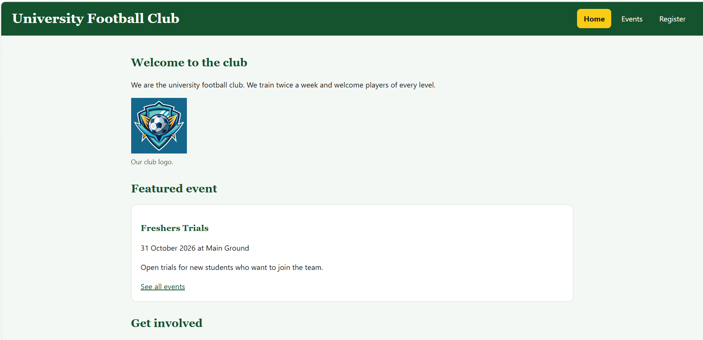

# cit331-Assignment-1_0031

# University Football Club Website

**Name:**  Syed Ukasha Shahid 
**Roll No.:** 0031

## About the club

This is a small website for a university football club. It shows the club's upcoming events, lets students register for an event with a form, and keeps the saved registrations in the browser. It was built by hand with HTML, CSS and a little JavaScript for CIT331 Assignment 1.

## Pages

- index.html: Home page with the club description and a featured event
- events.html: List of four upcoming events
- register.html: Registration form and the table of saved registrations

## How to open the site locally

1. Download or clone this repository.
2. Open the folder in VS Code.
3. Right-click index.html and choose Open with Live Server.
(You can also double-click index.html to open it in a browser.)

## Live site

https://github.com/syedukashashahid/cit331-Assignment-1_0031

## Screenshot

## Image sources

- images/logo.png: https://www.vecteezy.com/vector-art/47198293-football-team-logo-design-illustration-on-solid-background
